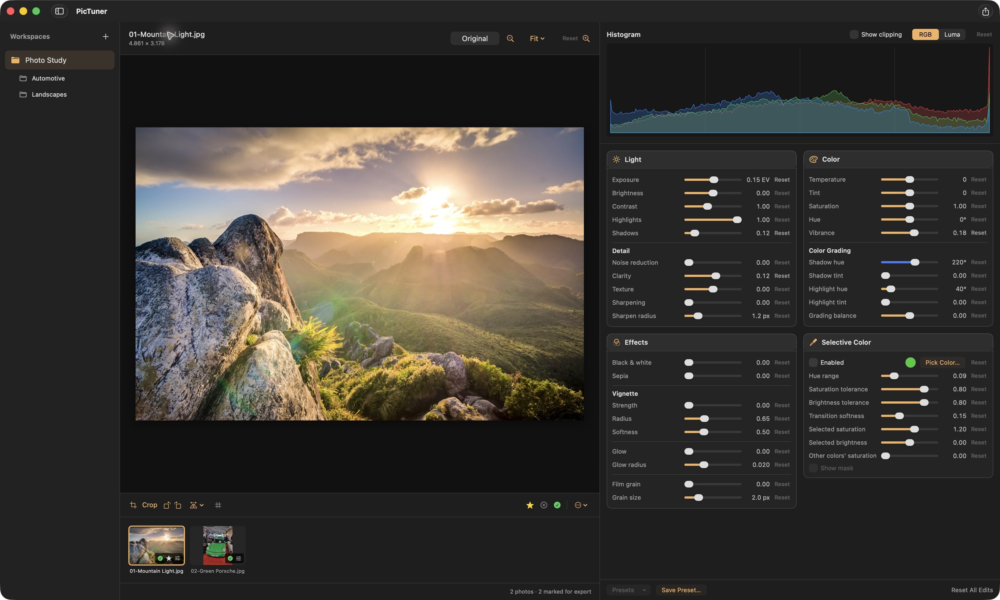
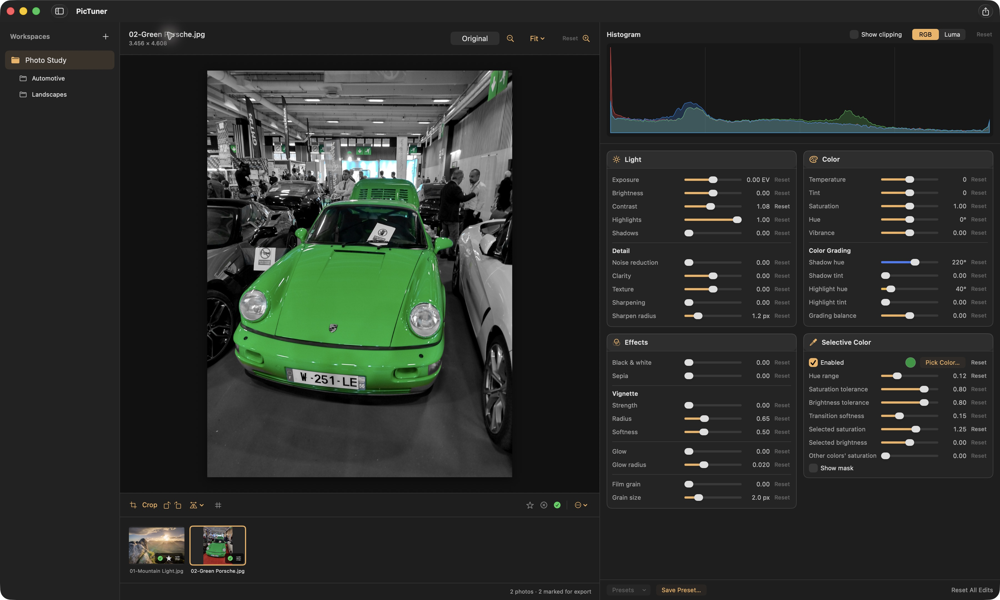
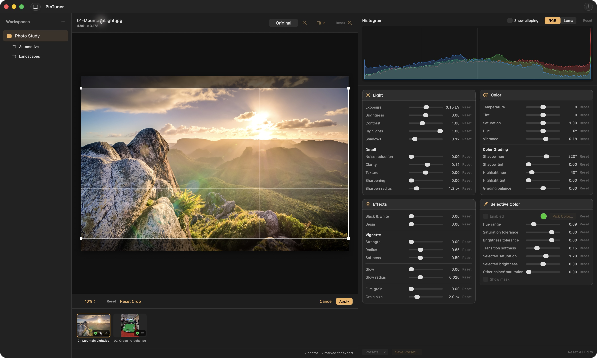

<p align="center">
  
</p>

<h1 align="center">PicTuner</h1>

<p align="center">A native macOS photo editor for quick, non-destructive edits across whole folders.</p>

Browse your photos, tune their look, and export the keepers. PicTuner works directly with existing folders, remembers each photo’s edits, and leaves the originals untouched.



## Features

- **Folder workspaces.** Add a folder and browse its images and nested folders, with a filmstrip, arrow-key navigation, favorites, and rejection flags. Hide the workspace sidebar to move the filmstrip beneath the right inspector and give portrait photos more preview space.
- **Live adjustments.** Change exposure, contrast, highlights, shadows, white balance, hue, saturation, and vibrance while the preview updates as you drag. The two-column inspector keeps all adjustments visible without scrolling.
- **Detail and effects.** Tune clarity, texture, sharpening, noise reduction, black & white, sepia, vignette, glow, film grain, and shadow/highlight color grading. Each slider has its own reset.
- **Selective color.** Pick a color from the photo, accentuate similar tones, and desaturate the rest. Adjust the matching range and softness, or inspect the selection mask.
- **Framing and detail.** Crop with aspect-ratio presets, straighten with an angle slider or horizon guide, rotate in 90° steps, mirror horizontally or vertically, and toggle a 3×3 composition grid. Zoom to actual source pixels or beyond and pan to inspect details.
- **Distraction-free viewing.** Hide the surrounding panels with ⇧⌘F and return with Escape. Navigation, zoom, and hold-Space comparison stay available.
- **Before/after wipe.** Toggle with ⌘\, then drag the divider between original and edited views, including while zoomed.
- **Original comparison and histogram.** Hold Space or the Original button to compare, with your current framing and zoom retained. View RGB/luminance histograms and clipping indicators.
- **Reusable edits.** Save color presets, copy and paste adjustments, or apply them to multiple selected photos. Each photo keeps its own framing and Date & GPS label.
- **Date & GPS labels.** Add the photo’s EXIF capture time and coordinates from the toolbar, choose one of six positions, and adjust margins and text size. Labels appear in exported copies; missing fields stay absent.
- **Export recipes.** Choose Web Page (full-resolution JPEG 80%), Instagram (JPEG 100%), Full Resolution (JPEG 95%), or Lossless (16-bit PNG). All four keep full rendered dimensions, and settings remain editable.
- **Deliberate export.** Mark photos with **Include in Export**, then export just those photos as JPEG or PNG, with optional resizing and subfolder preservation.
- **RAW support.** Develop camera RAW files using macOS’s RAW decoder, alongside JPEG, PNG, and HEIC/HEIF. Supported cameras and formats depend on the host macOS version.

Everything runs locally. No accounts, cloud uploads, analytics, or third-party application dependencies.

### Selective color

Keep a chosen color prominent while reducing saturation elsewhere. Color matching applies across the image; it is not an object or brush mask.



### Crop and composition

Adjust framing with a contextual crop toolbar and a rule-of-thirds overlay. Apply the crop or cancel it before returning to editing.



## Build and run

Requires **macOS 26.6.2 or later** and an installed Xcode Swift toolchain. The package uses Swift tools version 6.0. The editor needs at least **1340 × 900 points** of content space and opens to the available screen area.

From the repository root:

```sh
./scripts/build-app.sh
open build/PicTuner.app
```

For an optimized build:

```sh
./scripts/build-app.sh release
```

The script builds and bundles `build/PicTuner.app` with a local ad-hoc signature. Distribution signing and notarization are not configured. To work on the source in Xcode, open `Package.swift`.

## Everyday workflow

1. Choose **Add Workspace…** and select a folder. Photos stay in place; subfolders appear in the sidebar.
2. Select a photo in the filmstrip. Click the preview to focus it, then use **← / →** to browse.
3. Adjust the image, crop or rotate as needed, and hold **Space** to check the original. Changes autosave as you work and survive image changes and app restarts.
4. Click the checkmark beside the photo controls, or press **⇧⌘G**, to mark a photo for export. Marked thumbnails display a green checkmark.
5. Choose **Export**, select JPEG or PNG and an output folder outside your registered workspaces, choose a recipe or adjust the settings, then export the marked photos.

Favorites and thumbnail selection do not mark a photo for export. Rejected photos are excluded. Export starts with all marked, non-rejected photos in the workspace; you can narrow the scope to a folder, selection, or favorites.

Command-click thumbnails to select several photos. The **Photo actions** menu (•••) contains copy/paste, batch adjustment, and batch export-marking actions when applicable.

## Keyboard shortcuts

| Action | Shortcut |
| --- | --- |
| Add workspace | ⌘O |
| Previous / next photo | ← / → with preview focused |
| Compare with original | Hold Space |
| Undo / redo edit | ⌘Z / ⇧⌘Z |
| Fit photo / actual pixels | ⌘0 / ⌘1 |
| Zoom in / out | ⌘+ / ⌘− |
| Show / hide Workspaces | ⌃⌘S |
| Crop and straighten | ⌘K |
| Distraction-free mode | ⇧⌘F; Esc to exit |
| Before/after wipe | `⌘\` |
| Move comparison divider | Option–← / → |
| Apply / cancel crop | Return / Esc |
| Toggle Include in Export | ⇧⌘G |
| Copy / paste adjustments | ⇧⌘C / ⇧⌘V |
| Select all photos | ⇧⌘A |
| Export | ⇧⌘E |

You can also pinch or use the mouse wheel to zoom, drag or two-finger scroll to pan, and double-click to switch between Fit and 100% around the clicked point. At 100%, one source pixel maps to one display pixel, accounting for Retina scaling.

The angle control and horizon-guide button appear while cropping. Straighten trims the rotated edges automatically, with a range of −15° to +15°. **Apply** commits crop and angle together; **Cancel** discards both. Comparison retains this framing.

## Edits, originals, and exports

PicTuner stores per-photo adjustments, framing, and flags in **`.pictuner/workspace.json`** inside the workspace root. Keep that hidden folder with your photos to retain their edits. Workspace registrations and custom presets are stored separately in **`~/Library/Application Support/Pictuner/`**; that established storage name is intentional.

- Editing and export never rewrite, rename, or delete source photos.
- Preview, histogram, and export use the same ordered adjustment pipeline. For RAW comparison, “original” means the default RAW development, with the current crop and orientation retained.
- Exports are separate sRGB JPEG/PNG copies. Source EXIF and GPS tags are not copied to the output. Enabled Date & GPS labels are rendered into the picture.
- Export destinations must be outside every registered workspace. Existing output names can be renamed or skipped, never replaced; aliases and symbolic links are checked to protect sources.
- **Reset Workspace…** in a workspace’s context menu clears edits and favorite/reject/export flags throughout that workspace after confirmation. It keeps source files and saved presets. This reset cannot be undone.

## Development

PicTuner is implemented in **Swift, SwiftUI, AppKit, and Core Image** as a Swift Package executable.

Run the regression suite:

```sh
./scripts/test.sh
```

Include integration coverage with a real, supported camera RAW file:

```sh
PICTUNER_RAW_FIXTURE="/absolute/path/to/photo.NEF" ./scripts/test.sh
```

Rendering tests require access to macOS graphics services; restricted or headless environments can return empty Core Image buffers. See the development notes for the current verification results and known limitations.

| Reference | Contents |
| --- | --- |
| [Product specification](docs/SPEC.md) | Scope, behavior, and acceptance criteria |
| [Architecture](docs/ARCHITECTURE.md) | Rendering, persistence, concurrency, and export design |
| [Development notes](docs/DEVELOPMENT.md) | Implementation status, validation, and remaining work |
| [Agent instructions](AGENTS.md) | Rules for implementation work |
| [Screenshot notes](docs/screenshots/README.md) | Photo credits and capture details |

The app icon artwork lives in `Resources/AppIcon.png`. Run `./scripts/build-icon.sh` to regenerate its macOS icon sizes after changing it.

## License

PicTuner is available under the [MIT License](LICENSE). Photos shown in the screenshots retain their [credited licenses](docs/screenshots/README.md#photo-credits).
